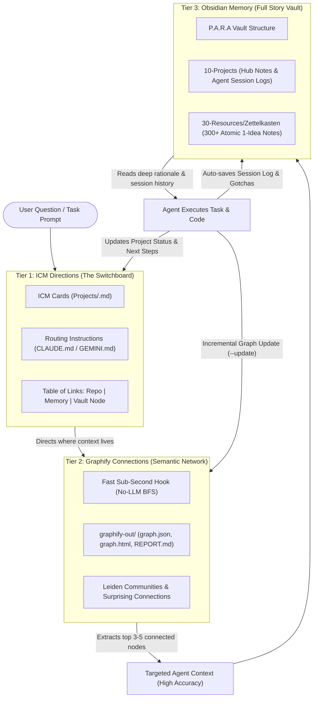

# Specification: Triad Context Engine — ICM Directions, Graphify Connections & Obsidian Memory

## 1. Executive Summary & Vision
This specification establishes a permanent 3-tier knowledge management and context retrieval architecture across all future and recent projects. The system solves the dual problems of **context window bloat** (dumping thousands of pages into an LLM) and **hallucination/drift** (agents losing track of decisions, architecture, and current status).

The architecture is divided into three specialized global skills installed in `~/.gemini/config/skills/`:
1. **`icm-directions` (Interpretable Context Methodology)**: The high-level compass and switchboard. Provides project and client micro-cards, status summaries, next steps, and exact pointers to where repositories, memories, and vault nodes reside. *"No stories, no bulky code — directions only."*
2. **`graphify-connections` (Semantic Graph & Sub-Second Pre-Prompt Retrieval)**: The semantic network and bridge finder. AST-parses code (zero hallucination) and chunks text across 22 concurrent workers into nodes and typed edges with provenance tags (`EXTRACTED`, `INFERRED`, `AMBIGUOUS`). Uses Leiden community clustering stored *outside* the vault (`graphify-out/`). Provides a zero-LLM local retrieval hook (`lookup-context.ps1/py`) executing in `< 50ms` that injects the top 3–5 densely connected nodes into agent context rather than 2,000 pages.
3. **`obsidian-memory` (P.A.R.A + Zettelkasten Vault)**: The deep historical memory and atomic knowledge base. Implements a central P.A.R.A vault with Project Hubs, automated Agent Session Logs (capturing: *What Was Built*, *Mistakes*, *Decisions*, *Wins*, *Gotchas*), and 300+ atomic Zettelkasten cards with `[[wikilinks]]`.

---

## 2. Global Architectural Topology



---

## 3. Skill 1: `icm-directions` (Interpretable Context Methodology)

### 3.1 Role & Boundary
- **Role**: High-level routing table, project status registry, and pointer map.
- **Location**: `C:\Users\provu\.gemini\config\skills\icm-directions\SKILL.md`
- **Invariants**:
  - Contains **only** pointers, statuses, and next steps. Never stores implementation code, long narratives, or raw transcripts.
  - Every project card must contain the standard **Table of Links**.

### 3.2 Workspace & Card Schema
The ICM system operates within an `ICM/` directory or root workspace routing table:
```text
ICM/
├── Clients/                  # Client registry cards
├── Projects/                 # Active project micro-cards
│   └── <ProjectName>.md
├── References/               # External standards and docs
└── Schemas/                  # JSON/Markdown schema validation rules
```

#### Project Card Standard Format (`Projects/<ProjectName>.md`)
```markdown
---
name: "<Project Name>"
type: project
status: active | on-hold | completed | archived
owner: "<Project Lead>"
last_updated: YYYY-MM-DD
---

# <Project Name>

## Current Status
- Brief 2-3 bullet summary of what is currently live, passing, and stable.

## Immediate Next Steps
- [ ] Next sequential priority item 1.
- [ ] Next sequential priority item 2.

## Table of Links
| Resource | Pointer / URI | Description |
|---|---|---|
| **Code Repository** | `file:///path/to/repo` | Root repository working directory |
| **Active Memory** | `file:///path/to/vault/10 - Projects/<Project>/Sessions/` | Chronological session notes & gotchas |
| **Vault Node** | `[[10 - Projects/<Project>/<Project>-Hub]]` | Central Obsidian hub node |
| **Knowledge Graph** | `file:///path/to/repo/graphify-out/graph.json` | Semantic entity and relation index |
```

---

## 4. Skill 2: `graphify-connections` (Semantic Graph & Sub-Second Pre-Prompt Retrieval)

### 4.1 Role & Boundary
- **Role**: Semantic network builder, community detector, and instant pre-prompt retrieval engine.
- **Location**: `C:\Users\provu\.gemini\config\skills\graphify-connections\SKILL.md`
- **Output Storage Boundary**: All graph outputs (`graph.json`, `graph.html`, `GRAPH_REPORT.md`) are saved strictly **outside the Obsidian vault** (in `graphify-out/` or project context) to keep the vault clean.

### 4.2 Extraction Pipeline
1. **Parallel Text Chunking**: Splits documentation, specifications, and long notes into **22 concurrent chunks** processed by parallel extraction workers.
2. **Code AST Parsing**: Code files (`.cs`, `.ts`, `.tsx`, `.py`, `.sql`) are processed via language AST parsers with zero LLM hallucination.
3. **Node Ontology**:
   - `Project`: System workspaces and sub-apps.
   - `Tool`: Compilers, libraries, frameworks, test runners.
   - `Decision`: Architectural and design choices adopted.
   - `Rationale`: The "why" behind an implementation or rule.
   - `Gotcha`: Pitfalls, race conditions, edge-case catches, and bugs.
   - `Concept`: Domain entities, models, and protocols.
4. **Typed Edges & Provenance**:
   - Edges: `references`, `rationale for`, `depends on`, `related to`.
   - **Provenance Tags**:
     - `EXTRACTED`: Explicit statement in text or code symbol (fact, confidence >= 0.95).
     - `INFERRED`: AI structural deduction with attached confidence score (0.50 - 0.94).
     - `AMBIGUOUS`: Unresolved contradiction or speculation (< 0.50).
5. **Leiden Community Detection**: Groups densely connected nodes into communities, highlighting cross-community bridge edges as "Surprising Connections".

### 4.3 Fast Zero-LLM Retrieval Hook (`scripts/lookup-context.ps1` / `.py`)
- **Execution Target**: `< 50ms` runtime, strictly 0 LLM calls.
- **Invocation**: `powershell -ExecutionPolicy Bypass -File ~/.gemini/config/skills/graphify-connections/scripts/lookup-context.ps1 -Query "<user question/task>"`
- **Behavior**:
  1. Tokenizes input query into keywords.
  2. Scans `graphify-out/graph.json` node labels and aliases.
  3. Traverses 1-hop connected neighbors of matched nodes.
  4. Ranks by node degree centrality and relation type.
  5. Formats and prints top **3 to 5 nodes** wrapped in `<graph-context>` XML tags.
  6. Injects only ~500–1,200 tokens into the agent's context window, bypassing the need to read 2,000+ vault pages.

---

## 5. Skill 3: `obsidian-memory` (P.A.R.A + Zettelkasten Vault)

### 5.1 Role & Boundary
- **Role**: Complete historical narrative, permanent memory, and atomic idea knowledge base.
- **Location**: `C:\Users\provu\.gemini\config\skills\obsidian-memory\SKILL.md`
- **Central Master Vault**: Default root at `~/Vaults/Master-Vault` (or configurable via `OBSIDIAN_VAULT_PATH`), containing dedicated project directories under `10 - Projects/<ProjectName>/`.

### 5.2 P.A.R.A Vault Directory Structure
```text
<VaultRoot>/
├── 00 - Inbox/                    # Raw clippings, incoming thoughts, unprocessed items
├── 10 - Projects/                 # Active projects
│   └── <ProjectName>/
│       ├── <Project>-Hub.md       # Master hub note connecting to specs and architecture
│       └── Sessions/              # Automated AI session notes
│           └── YYYY-MM-DD-session-HHmm.md
├── 20 - Areas/                    # Enduring domains (Security, Architecture, Standards)
├── 30 - Resources/                # Evergreen reference assets
│   └── Zettelkasten/              # 300+ Atomic 1-Idea Notes with [[wikilinks]]
│       └── <IdeaTitle>.md
├── 40 - Archive/                  # Completed, frozen, or deprecated project history
├── Attachments/                   # Media, diagrams, PDFs
├── Templates/                     # Reusable scaffolding templates
├── Home.md                        # Obsidian dashboard entry point
└── log.md                         # Global changelog / audit trail
```

### 5.3 Automated Agent Session Log Schema (`Sessions/YYYY-MM-DD-session-HHmm.md`)
Generated automatically upon task or milestone completion:
```markdown
---
type: session-log
project: "<Project Name>"
agent: "<Agent Name>"
timestamp: YYYY-MM-DDTHH:mm:ssZ
status: success | partial | blocked
tags: [session-log, <topic>]
---

# Session Log: <Topic / Feature Milestone>

## 1. What Was Built
- Concise summary of files created, modified, or migrated.

## 2. Mistakes & Friction Encountered
- Specific failure modes, compilation errors, or design mistakes encountered and how they were resolved.

## 3. Decisions & Rationale
- Key decisions made during the session and the reasoning behind each choice.

## 4. Wins & Verified Metrics
- Test suite outcomes, build duration, verification evidence, and performance stats.

## 5. Gotchas & Future Watchouts
- Critical warnings, race conditions, or prerequisites for the next developer/agent session.
```

### 5.4 Atomic Zettelkasten Card Schema (`30 - Resources/Zettelkasten/<Title>.md`)
- **Cardinality**: 1 idea, rule, or concept per file.
- **Properties**:
  ```yaml
  ---
  title: "<Idea Title>"
  type: concept | pattern | mechanism | rule | anti-pattern
  status: seed | evergreen | deprecated
  tags: [tag1, tag2, tag3]
  created: YYYY-MM-DD
  summary: "<One-sentence summary>"
  ---
  ```
- **Body**: Core concept explanation + concrete code/architecture example + explicit `[[wikilinks]]` linking to complementary Zettelkasten cards.

---

## 6. End-to-End AI Operating Cycle & Guidance Protocol

Whenever an AI agent operating with this triad receives a task:

1. **Phase 1: Orientation (Read-Time)**
   - Check `ICM/Projects/<Project>.md` for status and links.
   - Run `lookup-context.ps1 -Query "<user task>"` to retrieve top 3–5 connected graph nodes.
   - If deep historical context is needed, open the exact `[[wikilink]]` from Obsidian `10 - Projects/<Project>/`.
2. **Phase 2: Execution (Build-Time)**
   - Implement code adhering strictly to the extracted decisions and gotchas.
   - Track mistakes or unexpected behavior in memory.
3. **Phase 3: Persistence (Handoff-Time)**
   - Automatically write session log to `10 - Projects/<Project>/Sessions/YYYY-MM-DD-session-HHmm.md`.
   - Update `ICM/Projects/<Project>.md` with current status and next steps.
   - Trigger `graphify --update` to refresh `graphify-out/graph.json` with newly created symbols and decisions.

---

## 7. Edge Cases & Error Handling

1. **Missing Graph File**: If `graphify-out/graph.json` does not exist, `lookup-context.ps1` returns a non-blocking fallback message and instructions to run initial extraction.
2. **Broad Keyword Query**: Output is capped at **5 nodes** and **1,200 tokens** to prevent context contamination.
3. **Fact vs. AI Guess Integrity**: Nodes derived from `INFERRED` edges are prefixed with their confidence score; nodes with `< 75%` confidence are excluded from automatic context injection.
4. **Storage Cleanliness**: Graph HTML/JSON files are never written to the Obsidian vault root.

---

## 8. Verification & Acceptance Criteria
- **AC-01**: Three global skills installed with valid YAML frontmatter in `~/.gemini/config/skills/` (`icm-directions`, `graphify-connections`, `obsidian-memory`).
- **AC-02**: Fast retrieval script `lookup-context.ps1` executes in `< 50ms` on sample queries and produces `<graph-context>` blocks with top 3–5 nodes.
- **AC-03**: Automated session logger creates a fully formatted note in `Katipuneros-Vault/10 - Projects/Katipuneros/Sessions/` matching the required schema.
- **AC-04**: ICM project card parser validates and confirms all links in the Table of Links.
- **AC-05**: Automated verification script `scratch/verify_context_triad.ps1` executes all tests and reports 100% green.
