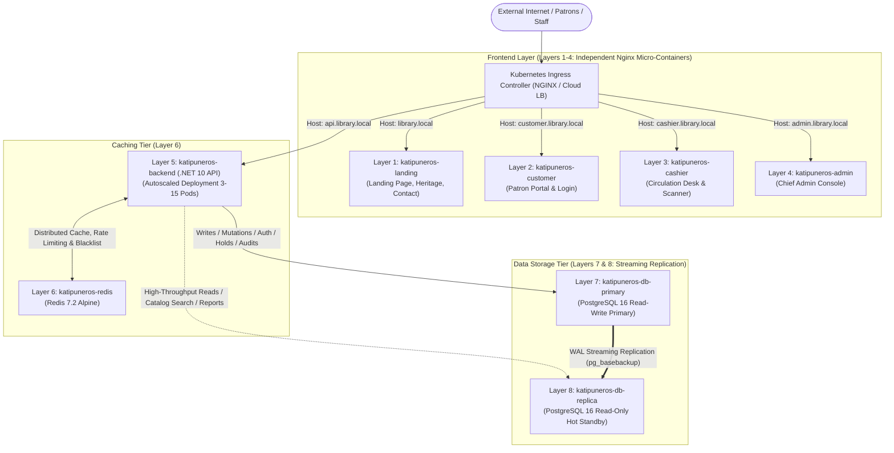

# Production Architecture Specification: 8-Layer Docker & Kubernetes Infrastructure

**Document ID**: SPEC-2026-10-17-K8S-8LAYER  
**Project**: Katipuneros Library Store System  
**Status**: APPROVED / SPECIFIED  
**Author**: Antigravity Enterprise Architecture Team  
**Date**: October 17, 2026  

---

## 1. Executive Summary & 8-Layer Architecture Topology

This specification defines the production-grade, enterprise containerization and Kubernetes orchestration architecture for the **Katipuneros Library Store System**. To achieve maximum security isolation, high availability, independent horizontal scalability, and optimal query throughput, the system is decomposed into **8 discrete, purpose-built layers**:

| Layer # | Tier | Service Name | Technology Stack | Ingress / Endpoint | Scaling Mode |
| :--- | :--- | :--- | :--- | :--- | :--- |
| **Layer 1** | Frontend Presentation | `katipuneros-landing` | Nginx 1.27 Alpine + React 19 SPA | `https://library.local` / `library.com` | HPA (2–10 Pods) |
| **Layer 2** | Frontend Presentation | `katipuneros-customer` | Nginx 1.27 Alpine + React 19 SPA | `https://customer.library.local` | HPA (2–10 Pods) |
| **Layer 3** | Frontend Presentation | `katipuneros-cashier` | Nginx 1.27 Alpine + React 19 SPA | `https://cashier.library.local` | Fixed (2 Pods) |
| **Layer 4** | Frontend Presentation | `katipuneros-admin` | Nginx 1.27 Alpine + React 19 SPA | `https://admin.library.local` | Fixed (2 Pods) |
| **Layer 5** | Application API | `katipuneros-backend` | .NET 10 ASP.NET Core Web API | `https://api.library.local` | HPA (3–15 Pods) |
| **Layer 6** | Distributed Cache | `katipuneros-redis` | Redis 7.2 Alpine | `katipuneros-redis:6379` (Internal) | Master + Sentinel / PVC |
| **Layer 7** | Primary Database | `katipuneros-db-primary` | PostgreSQL 16 Alpine (Read-Write) | `katipuneros-db-primary:5432` (Internal) | StatefulSet (1 Primary Pod) |
| **Layer 8** | Replica Database | `katipuneros-db-replica` | PostgreSQL 16 Alpine (Hot Standby) | `katipuneros-db-replica:5432` (Internal) | StatefulSet (1–5 Replica Pods) |



---

## 2. Frontend Layer Specifications (Layers 1 to 4)

### 2.1 Multi-Stage Container Build
All 4 frontend layers share a unified source tree in `Frontend/` but build into 4 ultra-lean, specialized Alpine Nginx images via Docker multi-stage targets:

1. **Build Stage (`node:22-alpine`)**:
   - Compiles TypeScript: `tsc -b`
   - Bundles optimized production assets: `vite build`
   - Generates deterministic hashed assets (`/assets/*.js`, `/assets/*.css`).
2. **Runtime Stage (`nginx:1.27-alpine-slim`)**:
   - Copies static assets from build stage to `/usr/share/nginx/html`.
   - Injects role-specific Nginx virtual host configuration.
   - Non-root user execution (`nginx` user, UID 101) for strict CIS Kubernetes compliance.

### 2.2 Portal Isolation & Nginx Configuration Details
Each frontend container runs a hardened `nginx.conf`:
- **HTML5 History API Fallback**:
  ```nginx
  location / {
      root /usr/share/nginx/html;
      index index.html;
      try_files $uri $uri/ /index.html;
  }
  ```
- **Static Asset Optimization**:
  ```nginx
  location /assets/ {
      root /usr/share/nginx/html;
      expires 1y;
      add_header Cache-Control "public, max-age=31536000, immutable";
      access_log off;
  }
  ```
- **Hardened Security Headers**:
  - `X-Frame-Options: SAMEORIGIN` (prevents clickjacking)
  - `X-Content-Type-Options: nosniff` (prevents MIME sniffing)
  - `Referrer-Policy: strict-origin-when-cross-origin`
  - `Content-Security-Policy: default-src 'self'; script-src 'self' 'unsafe-inline'; style-src 'self' 'unsafe-inline' https://fonts.googleapis.com; font-src 'self' https://fonts.gstatic.com; connect-src 'self' https://api.library.local http://127.0.0.1:5000; img-src 'self' data: https:;`

### 2.3 Portal Roles & Responsibilities
- **Layer 1 (`katipuneros-landing`)**:
  - Public routes: `/`, `/about`, `/products`, `/contact`.
  - Read-only public preview of historical manuscript collections and general book counts.
  - Links patrons to `https://customer.library.local` for holds and account signups.
- **Layer 2 (`katipuneros-customer`)**:
  - Patron routes: `/login`, `/signup`, `/customer/home`, `/customer/catalog`, `/customer/borrowings`, `/customer/reservations`, `/customer/favorites`, `/customer/profile`.
  - Client session strictly checks `user.role === 'Customer'`.
- **Layer 3 (`katipuneros-cashier`)**:
  - Cashier routes: `/cashier/login`, `/cashier/dashboard`, `/cashier/pending-reservations`, `/cashier/checkout`, `/cashier/returns`, `/cashier/customers`, `/cashier/book-availability`, `/cashier/schedules`, `/cashier/overdue-fines`, `/cashier/transactions`, `/cashier/notifications`, `/cashier/profile`.
  - QR Code scanner webcam access, physical accession lookup, hold triage approval/decline, damage fee assessments.
- **Layer 4 (`katipuneros-admin`)**:
  - Admin routes: `/admin/login`, `/admin/dashboard`, `/admin/users`, `/admin/books`, `/admin/reservations`, `/admin/borrowings`, `/admin/returns`, `/admin/inventory`, `/admin/analytics`, `/admin/categories`, `/admin/reports`, `/admin/notifications`, `/admin/roles`, `/admin/audit-logs`, `/admin/settings`, `/admin/profile`.
  - Chief administrator operations, audit trail inspection, user password resets, role grants.

---

## 3. Application API Layer Specification (Layer 5)

### 3.1 Containerization (.NET 10 ASP.NET Core)
- **Base Image**: `mcr.microsoft.com/dotnet/aspnet:10.0-alpine` (runtime ~98MB).
- **Build Image**: `mcr.microsoft.com/dotnet/sdk:10.0-alpine`.
- **Configuration**:
  - Port 5000 / 8080 non-root HTTP listener.
  - Kestrel tuned for high-concurrency asynchronous I/O.
  - Health probe endpoints:
    - `/healthz`: Liveness probe (verifies process is responsive).
    - `/ready`: Readiness probe (validates connectivity to Primary DB, Replica DB, and Redis cache).

### 3.2 Database Provider Migration & Read/Write Splitting
1. **PostgreSQL Migration**:
   - Replace `Microsoft.EntityFrameworkCore.SqlServer` with `Npgsql.EntityFrameworkCore.PostgreSQL` (Version 9.0+ / 10.0 compatible).
   - Convert SQL Server `DATETIME2` and `BIT` column types to PostgreSQL `timestamptz` and `boolean`.
   - Update `appsettings.Production.json` to ingest:
     - `ConnectionStrings:PrimaryConnection`: `Host=katipuneros-db-primary;Port=5432;Database=KatipunerosLibraryDb;Username=katipuneros_admin;Password=...;Include Error Detail=true;`
     - `ConnectionStrings:ReplicaConnection`: `Host=katipuneros-db-replica;Port=5432;Database=KatipunerosLibraryDb;Username=katipuneros_reader;Password=...;Application Name=Katipuneros_ReadReplica;`
2. **CQRS Dual DbContext Architecture**:
   - `AppDbContext` (Read-Write):
     - Injected into all mutation services (`BorrowService`, `ReservationService`, `UserService`, `ReturnService`, `AuditService`).
     - Directly handles database migrations via EF Core CLI / startup migration container.
   - `ReadOnlyAppDbContext` (Read-Only):
     - Injected into high-throughput query services (`BookService.GetBooksAsync`, `CategoryService.GetAllCategoriesAsync`, `ReportService`, catalog search).
     - Configured with `ChangeTracker.QueryTrackingBehavior = QueryTrackingBehavior.NoTracking` for 30–50% reduced GC overhead and zero lock contention with transactions.

---

## 4. Distributed Cache Layer Specification (Layer 6)

### 4.1 Redis 7.2 Alpine Setup
- **Container**: `redis:7.2-alpine` with custom `redis.conf`:
  - `maxmemory 512mb`
  - `maxmemory-policy allkeys-lru`
  - `appendonly yes` (AOF persistence to avoid cache stampede on restarts).
  - Internal password authentication via Kubernetes Secret.

### 4.2 Distributed Functionality in Backend
1. **Catalog & Reference Data Caching**:
   - `ICacheService` implementation wraps `IDistributedCache` (`Microsoft.Extensions.Caching.StackExchangeRedis`).
   - Caches categories (`cache:categories:all`, TTL 1 hour).
   - Caches book spotlight collections and catalog pages (`cache:books:spotlight`, `cache:books:page:*`, TTL 15 minutes).
   - Invalidation events triggered automatically on book updates, checkouts, or category modifications.
2. **Distributed Sliding-Window Rate Limiting**:
   - Replaces in-memory rate-limiting dictionaries (`_requests` static map).
   - Implements Redis atomic token-bucket / sliding-log key: `ratelimit:{ip}:{action}` with TTL expiration.
   - Ensures rate limits remain consistent even when Backend API scales across 10 pods.
3. **JWT Revocation & Session Blacklist**:
   - Stores revoked JWT `jti` tokens on explicit logout with TTL matching token remaining lifetime.
   - Fast sub-millisecond lookup in authentication middleware.

---

## 5. Database Cluster Specifications (Layers 7 & 8)

### 5.1 Architecture: Primary & Streaming Read-Replica

```
  ┌────────────────────────────────────────────────────────┐
  │         Layer 7: katipuneros-db-primary                │
  │                  (PostgreSQL 16)                       │
  │  - Read/Write Queries                                  │
  │  - wal_level = replica                                 │
  │  - max_wal_senders = 10                                │
  │  - Persistent Volume: katipuneros-primary-pvc (50Gi)   │
  └──────────────────────────┬─────────────────────────────┘
                             │
                             │ PostgreSQL Physical Streaming
                             │ Replication via WAL over TCP :5432
                             ▼
  ┌────────────────────────────────────────────────────────┐
  │         Layer 8: katipuneros-db-replica                │
  │                  (PostgreSQL 16)                       │
  │  - Read-Only Queries (hot_standby = on)                │
  │  - Initialized with pg_basebackup                      │
  │  - standby.signal present                              │
  │  - Persistent Volume: katipuneros-replica-pvc (50Gi)   │
  └────────────────────────────────────────────────────────┘
```

### 5.2 Layer 7: Primary Database (`katipuneros-db-primary`)
- **Role**: Authoritative transactional database for all write operations.
- **Initialization & Configuration**:
  - Dedicated replication user created on bootstrap:
    ```sql
    CREATE ROLE replicator WITH REPLICATION LOGIN ENCRYPTED PASSWORD 'KatipunerosReplPass_2026!';
    ```
  - `postgresql.conf` tuning:
    - `wal_level = replica`
    - `max_wal_senders = 10`
    - `wal_keep_size = 512MB`
    - `hot_standby = on`
    - `shared_buffers = 512MB`
    - `effective_cache_size = 1536MB`
  - `pg_hba.conf` allows replication connections from Layer 8:
    ```
    host replication replicator 0.0.0.0/0 scram-sha-256
    ```
- **Storage**: Backed by Kubernetes PersistentVolumeClaim with Retain policy.

### 5.3 Layer 8: Replica Database (`katipuneros-db-replica`)
- **Role**: Read-only hot standby serving catalog browsing, analytics, and reporting.
- **Automated Bootstrap Procedure**:
  - If data directory is uninitialized, replica runs an init-container:
    ```bash
    pg_basebackup -h katipuneros-db-primary -D /var/lib/postgresql/data -U replicator -Fp -Xs -R -v
    ```
  - The `-R` flag writes connection configuration and creates `standby.signal`.
  - Starts up in `hot_standby = on` mode, receiving continuous WAL records from Primary.
  - Rejects any accidental write statements (`SELECT ... FOR UPDATE`, `INSERT`, `UPDATE`, `DELETE`) with `ERROR: cannot execute ... in a read-only transaction`.

---

## 6. Docker Compose Orchestration (Local Dev / Staging)

The project includes `docker/docker-compose.yml` defining the complete 8-service topology on a private bridge network (`katipuneros-net`):

```yaml
version: '3.8'

services:
  # Layer 7: Primary Database (Read-Write)
  katipuneros-db-primary:
    image: postgres:16-alpine
    container_name: katipuneros-db-primary
    environment:
      POSTGRES_DB: KatipunerosLibraryDb
      POSTGRES_USER: katipuneros_admin
      POSTGRES_PASSWORD: KatipunerosDbPassword_2026!
      POSTGRES_REPLICATION_USER: replicator
      POSTGRES_REPLICATION_PASSWORD: KatipunerosReplPass_2026!
    volumes:
      - primary-data:/var/lib/postgresql/data
      - ./postgres/primary-init.sh:/docker-entrypoint-initdb.d/01-init.sh:ro
    ports:
      - "5432:5432"
    networks:
      - katipuneros-net

  # Layer 8: Replica Database (Read-Only)
  katipuneros-db-replica:
    image: postgres:16-alpine
    container_name: katipuneros-db-replica
    depends_on:
      - katipuneros-db-primary
    volumes:
      - replica-data:/var/lib/postgresql/data
      - ./postgres/replica-init.sh:/docker-entrypoint-initdb.d/01-init.sh:ro
    ports:
      - "5433:5432"
    networks:
      - katipuneros-net

  # Layer 6: Redis Distributed Cache
  katipuneros-redis:
    image: redis:7.2-alpine
    container_name: katipuneros-redis
    command: ["redis-server", "--requirepass", "KatipunerosRedisSecret_2026!"]
    volumes:
      - redis-data:/data
    ports:
      - "6379:6379"
    networks:
      - katipuneros-net

  # Layer 5: Backend API (.NET 10)
  katipuneros-backend:
    build:
      context: ..
      dockerfile: docker/Dockerfile.backend
    container_name: katipuneros-backend
    environment:
      - ASPNETCORE_ENVIRONMENT=Production
      - ConnectionStrings__PrimaryConnection=Host=katipuneros-db-primary;Port=5432;Database=KatipunerosLibraryDb;Username=katipuneros_admin;Password=KatipunerosDbPassword_2026!;
      - ConnectionStrings__ReplicaConnection=Host=katipuneros-db-replica;Port=5432;Database=KatipunerosLibraryDb;Username=katipuneros_admin;Password=KatipunerosDbPassword_2026!;
      - Redis__ConnectionString=katipuneros-redis:6379,password=KatipunerosRedisSecret_2026!
    ports:
      - "5000:5000"
    depends_on:
      - katipuneros-db-primary
      - katipuneros-db-replica
      - katipuneros-redis
    networks:
      - katipuneros-net

  # Layer 1: Landing Page
  katipuneros-landing:
    build:
      context: ../Frontend
      dockerfile: ../docker/Dockerfile.frontend
      args:
        PORTAL_TARGET: landing
    container_name: katipuneros-landing
    ports:
      - "5173:80"
    networks:
      - katipuneros-net

  # Layer 2: Customer Portal
  katipuneros-customer:
    build:
      context: ../Frontend
      dockerfile: ../docker/Dockerfile.frontend
      args:
        PORTAL_TARGET: customer
    container_name: katipuneros-customer
    ports:
      - "5176:80"
    networks:
      - katipuneros-net

  # Layer 3: Cashier Desk
  katipuneros-cashier:
    build:
      context: ../Frontend
      dockerfile: ../docker/Dockerfile.frontend
      args:
        PORTAL_TARGET: cashier
    container_name: katipuneros-cashier
    ports:
      - "5175:80"
    networks:
      - katipuneros-net

  # Layer 4: Chief Admin Console
  katipuneros-admin:
    build:
      context: ../Frontend
      dockerfile: ../docker/Dockerfile.frontend
      args:
        PORTAL_TARGET: admin
    container_name: katipuneros-admin
    ports:
      - "5174:80"
    networks:
      - katipuneros-net

networks:
  katipuneros-net:
    driver: bridge

volumes:
  primary-data:
  replica-data:
  redis-data:
```

---

## 7. Kubernetes Production Manifests Architecture

All production Kubernetes manifests reside in `k8s/`:

```
k8s/
├── 00-namespace.yaml             # Namespace: katipuneros-prod
├── 01-secrets.yaml               # SealedSecrets / K8s Secrets (DB, Redis, JWT, SMTP)
├── 02-configmaps.yaml            # Portal Nginx Configs, DB Replication Configs, Backend Settings
├── 03-persistent-volumes.yaml    # PVC definitions for Primary DB, Replica DB, Redis
├── 04-layer7-primary-db.yaml     # StatefulSet + Headless & ClusterIP Service (Primary DB)
├── 05-layer8-replica-db.yaml     # StatefulSet + ClusterIP Service (Read Replica DB)
├── 06-layer6-redis.yaml          # Deployment + ClusterIP Service (Redis Cache)
├── 07-layer5-backend.yaml        # Deployment + Service + HorizontalPodAutoscaler (Backend API)
├── 08-layer1-landing.yaml        # Deployment + Service + HPA (Landing Portal)
├── 09-layer2-customer.yaml       # Deployment + Service + HPA (Customer Portal)
├── 10-layer3-cashier.yaml        # Deployment + Service (Cashier Desk)
├── 11-layer4-admin.yaml          # Deployment + Service (Chief Admin Console)
└── 12-ingress.yaml               # Ingress with TLS and Subdomain Routing
```

### 7.1 Ingress Routing Specification (`12-ingress.yaml`)
```yaml
apiVersion: networking.k8s.io/v1
kind: Ingress
metadata:
  name: katipuneros-ingress
  namespace: katipuneros-prod
  annotations:
    kubernetes.io/ingress.class: nginx
    cert-manager.io/cluster-issuer: letsencrypt-prod
    nginx.ingress.kubernetes.io/ssl-redirect: "true"
    nginx.ingress.kubernetes.io/proxy-body-size: "20m"
spec:
  tls:
    - hosts:
        - library.local
        - customer.library.local
        - cashier.library.local
        - admin.library.local
        - api.library.local
      secretName: katipuneros-tls-cert
  rules:
    - host: library.local
      http:
        paths:
          - path: /
            pathType: Prefix
            backend:
              service:
                name: katipuneros-landing-svc
                port:
                  number: 80
    - host: customer.library.local
      http:
        paths:
          - path: /
            pathType: Prefix
            backend:
              service:
                name: katipuneros-customer-svc
                port:
                  number: 80
    - host: cashier.library.local
      http:
        paths:
          - path: /
            pathType: Prefix
            backend:
              service:
                name: katipuneros-cashier-svc
                port:
                  number: 80
    - host: admin.library.local
      http:
        paths:
          - path: /
            pathType: Prefix
            backend:
              service:
                name: katipuneros-admin-svc
                port:
                  number: 80
    - host: api.library.local
      http:
        paths:
          - path: /
            pathType: Prefix
            backend:
              service:
                name: katipuneros-backend-svc
                port:
                  number: 5000
```

---

## 8. Verification & Validation Protocol

The architecture must satisfy the following machine-verifiable gates:
1. **Container Compilation Gate**:
   - `docker build -f docker/Dockerfile.frontend --target landing` succeeds.
   - `docker build -f docker/Dockerfile.frontend --target customer` succeeds.
   - `docker build -f docker/Dockerfile.frontend --target cashier` succeeds.
   - `docker build -f docker/Dockerfile.frontend --target admin` succeeds.
   - `docker build -f docker/Dockerfile.backend` succeeds with 0 .NET build warnings.
2. **PostgreSQL Streaming Replication Gate**:
   - Primary `SELECT pg_is_in_recovery();` returns `false`.
   - Replica `SELECT pg_is_in_recovery();` returns `true`.
   - Writing a record to Primary immediately surfaces on Replica within < 50ms replication lag.
3. **Redis Distributed State Gate**:
   - Rate limiter blocks requests beyond threshold across multiple backend pods.
   - Cache invalidation on book edit purges key from Redis immediately.
4. **Ingress Subdomain Isolation Gate**:
   - Each portal subdomain serves only its authorized layout and routes.
   - Deep-linking refresh tests return HTTP 200 via Nginx HTML5 history fallback.
