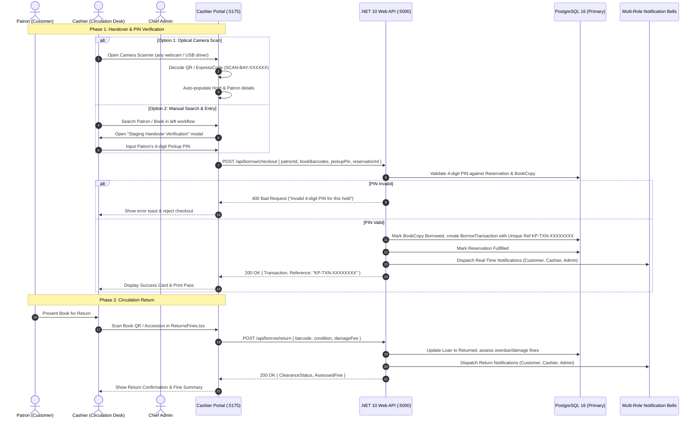

# Design Specification: Dual-Mode QR/Camera & 4-Digit PIN Handover Verification System

## Status: APPROVED FOR IMPLEMENTATION
**Date**: 2026-10-17  
**Author**: Antigravity & Lead Architecture Team  
**Scope**: Frontend (Patron, Cashier, Admin Portals), Backend (.NET 10 API, EF Core), and Obsidian Knowledge Base  

---

## 1. Executive Summary & Problem Statement

In the Katipuneros Library Store circulation workflow:
1. When patrons reserve a book and an approval is granted, an official User Slip is issued with an **ExpressCode** (`SCAN-BAY-XXXXXX`), optical **QR Code**, and a **4-digit Pickup PIN**.
2. At the circulation desk, cashiers must verify that the patron claiming the physical copy is indeed the legitimate hold holder.
3. To prevent fraudulent collection, checkout must enforce verification through either:
   - **Option 1 (Optical Camera Scanner)**: Scanning the patron's QR Code or ExpressCode with an integrated camera (supporting any webcam, internal driver, or USB hardware reader).
   - **Option 2 (Manual Directory Search)**: Searching the patron by name, email, or library card ID, selecting the held title, and typing the patron's unique 4-digit Pickup PIN in a dedicated handover modal.
4. The 4-digit PIN must be **strictly unique** across active holds for that specific book title, QR code, and physical `BookCopy`.
5. Upon confirmation of borrow, a **unique transaction reference** (`KP-TXN-XXXXXXXX`) must be issued and notified to the **notification bells** of Customer, Cashier, and Admin.
6. Upon confirmation of return, the return clearance and audit record must also update the **notification bells** of Customer, Cashier, and Admin.

---

## 2. Architectural Components

---

## 3. Detailed Specifications

### 3.1. 4-Digit Pickup PIN Uniqueness & Generation
- **Algorithm**: In `ReservationService.cs`:
  - When a reservation is triaged/approved (`TriageReservationAsync` or `AssignLockerAsync`), generate a 4-digit PIN between `1000` and `9999`.
  - Validate against existing active reservations (`StagedInLocker`, `Pending`):
    - `existingPins = await _context.Reservations.Where(r => r.BookId == bookId && r.Status == ReservationStatus.StagedInLocker).Select(r => r.LockerPin).ToListAsync();`
    - If collision exists, regenerate until a unique PIN for that title/physical copy is selected.
    - Also allow a deterministic seed: `((bookCopyId.GetHashCode() ^ reservationId.GetHashCode()) & 0x7FFFFFFF) % 9000 + 1000`.

### 3.2. Cashier Desk Handover Modal in `CheckoutBorrow.tsx`
- **Modal Component (`HandoverVerificationModal`)**:
  - Rendered when cashier clicks "Verify & Stage" on an active hold or when an ExpressCode `SCAN-BAY-XXXXXX` is scanned/entered.
  - **Option 1 (Camera Scanner)**:
    - Button: "Open Camera Scanner" launching `<video>` element with device switcher supporting all available video inputs (`navigator.mediaDevices.enumerateDevices()`).
    - Decodes QR payloads or ExpressCode strings using barcode detector or optical scanner fallback.
    - Displays camera live preview with target reticle.
  - **Option 2 (Manual PIN Entry)**:
    - 4 large monospace input boxes (auto-focusing next digit on entry) for the 4-digit PIN.
    - Displays hold info: Title, Author, Staged Bay, Patron Name, Reference ID.
    - "Validate & Confirm Checkout" button.
    - Validates against `res.lockerPin`.

### 3.3. Unique Transaction Reference Engine
- In `BorrowService.cs`:
  - Format: `KP-TXN-{DateTime.UtcNow:yyyyMMdd}-{RandomHex(6)}` (e.g. `KP-TXN-20261017-9F4B2C`).
  - Stored in `BorrowTransaction.GatePassCode` and transaction audit metadata.
  - Returned in checkout response payload.

### 3.4. Multi-Role Notification Bell Synchronization
- **Borrow Confirmation Notifications**:
  - **Patron (Customer)**: `"Your borrow for '{title}' (Ref: {Ref}) is confirmed at {bay}. Return by {DueDate}."` (Type: `PickupReady` / `Info`, Category: `Loan`).
  - **Cashier**: `"Circulation checkout confirmed for {PatronName} - Volume: '{title}' (Ref: {Ref})."` (Type: `Success`, Category: `Circulation`).
  - **Admin**: `"Circulation Audit: {PatronName} checked out '{title}' under transaction {Ref}."` (Type: `Audit`, Category: `System`).
- **Return Confirmation Notifications**:
  - **Patron (Customer)**: `"Your return of '{title}' (Ref: {Ref}) was verified and cleared. Thank you for returning on time!"` (or overdue/damage fine warning).
  - **Cashier**: `"Book returned: '{title}' checked in by {PatronName} and restocked to {bay}."`
  - **Admin**: `"Inventory Restock: Physical copy of '{title}' successfully returned to active stacks."`
- **Frontend Real-Time Notification Bells**:
  - All 3 portals (`CustomerDashboard.tsx` / `NotificationUI.tsx`, `CashiersPanel/Pages/Notifications.tsx`, and `AdminsPanel/Shared/NotificationUI.tsx`) subscribe to local storage events + custom dispatch events (`circulation-borrow-confirmed`, `circulation-return-confirmed`) and poll `/api/notifications/alerts` or `/api/notifications` to ensure bells update immediately with red unread badges.

---

## 4. Subagent Allocation Plan (5 Subagents)

As requested, we will deploy 5 parallel subagents:
1. **Subagent 1 (Backend PIN & Borrow Service Engineer)**:
   - Update `ReservationService.cs` with collision-free PIN generation.
   - Update `BorrowController.cs` & `BorrowService.cs` to validate 4-digit PIN and issue `KP-TXN-XXXXXXXX` references.
   - Update `ReturnBookAsync` to generate multi-user return notification records.
2. **Subagent 2 (Cashier Handover Verification Modal & Camera Scanner Engineer)**:
   - Create camera scanner modal in `CheckoutBorrow.tsx` supporting internal/USB camera drivers.
   - Implement the 4-digit PIN validation modal and auto-fill logic.
3. **Subagent 3 (Circulation Returns & Fine Clearance Notification Engineer)**:
   - Enhance `ReturnsFines.tsx` to handle QR/ExpressCode scan with return notification dispatches and transaction cross-referencing.
4. **Subagent 4 (Cross-Portal Notification Bells Synchronization Specialist)**:
   - Ensure the notification bell component across Customer, Cashier, and Admin panels reflects live borrow and return notifications with unread counts and links.
5. **Subagent 5 (Full-Stack Verification, Test Harness & Obsidian Documentation Specialist)**:
   - Create `scratch/verify_pin_verification_and_notifications.ps1` to verify PIN validation, transaction generation, and notification delivery.
   - Update Obsidian Vault documentation with the new circulation protocol.

---

## 5. Acceptance Criteria
1. ExpressCode `SCAN-BAY-XXXXXX` and QR Code trigger handover verification in `CheckoutBorrow.tsx`.
2. 4-digit PIN input validates against the held reservation before checkout is permitted.
3. 4-digit PIN is strictly unique for the given book title and physical copy.
4. Completed checkouts emit unique `KP-TXN-XXXXXXXX` reference code.
5. Notification bells across Customer, Cashier, and Admin portals update upon both borrow confirmation and return confirmation.
6. Clean build on both Backend (`0 errors`) and Frontend (`0 errors`).
