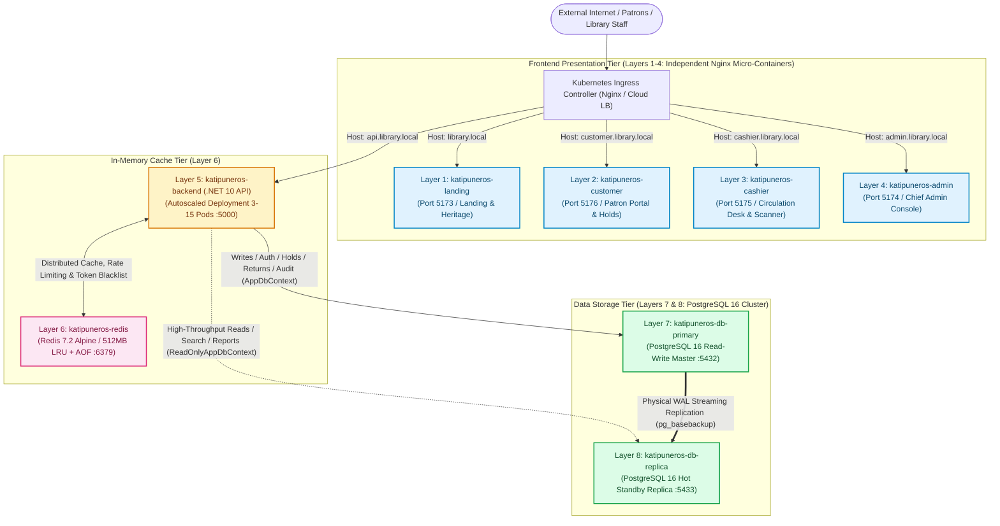

---
title: 8-Layer Docker & Kubernetes Production Architecture
created: 2026-10-17
tags:
  - architecture
  - docker
  - kubernetes
  - infrastructure
  - postgresql
  - redis
  - nginx
  - dotnet
  - high-availability
aliases:
  - 8-Layer Architecture
  - Production Infrastructure
  - Containerization Spec
---

# 🏗️ 8-Layer Docker & Kubernetes Production Architecture

> [!NOTE] Architecture Context
> The **Katipuneros Library Store System** operates a hardened, 8-layer micro-tier containerization topology designed for strict role isolation, zero-trust perimeter routing, read/write database scaling, and distributed in-memory caching.
> 
> Related Vault Docs: [[01-Architecture-Wiki/Circulation-QRCode-and-UserSlip-Standard|Circulation QR & User Slip Standard]] | [[01-Architecture-Wiki/CRUD-Verification-Playbook|CRUD Verification Playbook]] | [[03-Agent-Memory/MEMORY|System Invariants]]

---

## 1. 8-Layer Architecture Matrix

| Layer # | Tier Category | Service / Container Name | Technology Stack | Ingress / Endpoint | Port Mapping | Scaling Policy | Health Probes |
| :--- | :--- | :--- | :--- | :--- | :--- | :--- | :--- |
| **Layer 1** | Frontend Presentation | `katipuneros-landing` | Nginx 1.27 Alpine + React 19 SPA | `https://library.local` | `5173:80` | HPA (2–10 Pods) | HTTP GET `/` (Nginx) |
| **Layer 2** | Frontend Presentation | `katipuneros-customer` | Nginx 1.27 Alpine + React 19 SPA | `https://customer.library.local` | `5176:80` | HPA (2–10 Pods) | HTTP GET `/` (Nginx) |
| **Layer 3** | Frontend Presentation | `katipuneros-cashier` | Nginx 1.27 Alpine + React 19 SPA | `https://cashier.library.local` | `5175:80` | Fixed (2 Pods) | HTTP GET `/` (Nginx) |
| **Layer 4** | Frontend Presentation | `katipuneros-admin` | Nginx 1.27 Alpine + React 19 SPA | `https://admin.library.local` | `5174:80` | Fixed (2 Pods) | HTTP GET `/` (Nginx) |
| **Layer 5** | Application API | `katipuneros-backend` | .NET 10 ASP.NET Core Web API | `https://api.library.local` | `5000:5000` | HPA (3–15 Pods) | `/healthz` & `/ready` |
| **Layer 6** | Distributed Cache | `katipuneros-redis` | Redis 7.2 Alpine + AOF | `katipuneros-redis:6379` | `6379:6379` | Master + PVC | `redis-cli ping` |
| **Layer 7** | Primary Database | `katipuneros-db-primary` | PostgreSQL 16 Alpine (Read-Write) | `katipuneros-db-primary:5432` | `5432:5432` | StatefulSet (1 Pod) | `pg_isready -h localhost` |
| **Layer 8** | Replica Database | `katipuneros-db-replica` | PostgreSQL 16 Alpine (Hot Standby) | `katipuneros-db-replica:5432` | `5433:5432` | StatefulSet (1–5 Pods) | `pg_isready` & `standby.signal` |

---

## 2. Full Architecture Topology Diagram



---

## 3. Detailed Specifications for Each Layer

### 3.1 Layers 1 to 4: Specialized Presentation Portals

All four frontend applications are built from a unified TypeScript source (`Frontend/`) using Docker multi-stage targets in `docker/Dockerfile.frontend`:

1. **Build Stage (`node:22-alpine`)**:
   - Executes type compilation `tsc -b` and bundler optimization `vite build`.
   - Strips development hooks and bundles tree-shaken static chunks with deterministic content hashes.
2. **Runtime Stage (`nginx:1.27-alpine-slim`)**:
   - Deploys static build output to `/usr/share/nginx/html`.
   - Runs as non-root unprivileged `nginx` user (UID 101) to satisfy strict CIS Kubernetes security benchmarks.
   - Enforces HTML5 History API routing fallback:
     ```nginx
     location / {
         root /usr/share/nginx/html;
         index index.html;
         try_files $uri $uri/ /index.html;
     }
     ```
   - Applies long-term immutable caching for static assets:
     ```nginx
     location /assets/ {
         root /usr/share/nginx/html;
         expires 1y;
         add_header Cache-Control "public, max-age=31536000, immutable";
         access_log off;
     }
     ```

> [!TIP] Portal Isolation Matrix
> - **Layer 1 (`landing`)**: Public exhibition, historical manuscript previews, contact dispatch.
> - **Layer 2 (`customer`)**: Student/patron dashboard, catalog hold requests, downloadable User Slip PNG, borrowing ledger.
> - **Layer 3 (`cashier`)**: Desk circulation, live camera QR viewfinder, accession scan, once-only hold approval/decline triage, return fine audit.
> - **Layer 4 (`admin`)**: Institutional management, physical copy generation, bulk sticker printing, role assignment, audit logs.

---

### 3.2 Layer 5: Backend API (.NET 10 ASP.NET Core)

- **Base Image**: `mcr.microsoft.com/dotnet/aspnet:10.0-alpine` (ultra-lean runtime footprint ~98MB).
- **Execution Architecture**:
  - Non-root Kestrel web server running on port `5000`.
  - CQRS dual-context split:
    - **`AppDbContext`**: Targeted at Layer 7 Primary DB. Enforces transactional integrity for mutations (user registration, checkout loans, return settlements, hold triage).
    - **`ReadOnlyAppDbContext`**: Targeted at Layer 8 Read Replica DB. Explicitly configures `QueryTrackingBehavior.NoTracking`. Throws `InvalidOperationException` on any attempt to invoke `SaveChanges()`.
- **Health Probing**:
  - `/healthz`: Liveness check verifying process execution.
  - `/ready`: Readiness check asserting live connections to Primary PostgreSQL, Replica PostgreSQL, and Redis Cache.

---

### 3.3 Layer 6: Distributed In-Memory Cache (Redis 7.2)

- **Base Image**: `redis:7.2-alpine`.
- **Memory & Eviction Policy**:
  - `maxmemory 512mb` with `maxmemory-policy allkeys-lru` (Least Recently Used eviction).
  - Persistence enabled via Append-Only File (`appendonly yes`, `appendfsync everysec`) to eliminate cache stampedes during service restarts.
- **Backend Integrations**:
  1. **Catalog Cache**: Keys `cache:categories:all` (TTL 1h) and `cache:books:page:*` (TTL 15m), invalidated dynamically on book mutations.
  2. **Distributed Sliding-Window Rate Limiting**: Centralized atomic token bucket preventing brute-force login attempts across autoscaled API replicas.
  3. **JWT Blacklist**: High-speed O(1) revocation lookup on patron/staff logout.

---

### 3.4 Layer 7 & Layer 8: High-Availability PostgreSQL 16 Cluster

The data storage tier utilizes continuous physical streaming replication:

```
  ┌────────────────────────────────────────────────────────┐
  │         Layer 7: katipuneros-db-primary                │
  │                  (PostgreSQL 16)                       │
  │  - Read/Write Master                                   │
  │  - wal_level = replica                                 │
  │  - max_wal_senders = 10                                │
  │  - wal_keep_size = 512MB                               │
  │  - Persistent Volume Claim: 50Gi                      │
  └──────────────────────────┬─────────────────────────────┘
                             │
                             │ Physical WAL Streaming
                             │ (scram-sha-256 over TCP :5432)
                             â–¼
  ┌────────────────────────────────────────────────────────┐
  │         Layer 8: katipuneros-db-replica                │
  │                  (PostgreSQL 16)                       │
  │  - Read-Only Hot Standby (hot_standby = on)            │
  │  - Bootstrapped via pg_basebackup -R                   │
  │  - standby.signal present in data dir                  │
  │  - Persistent Volume Claim: 50Gi                      │
  └────────────────────────────────────────────────────────┘
```

#### Primary Configuration (`postgresql-primary.conf`)
```ini
listen_addresses = '*'
wal_level = replica
max_wal_senders = 10
wal_keep_size = 512MB
hot_standby = on
shared_buffers = 256MB
effective_cache_size = 768MB
work_mem = 16MB
maintenance_work_mem = 64MB
max_connections = 200
```

#### Replica Initialization & Standby Signal
During container startup, Layer 8 runs `replica-init.sh`:
```bash
if [ ! -f /var/lib/postgresql/data/standby.signal ]; then
  echo "Cloning from primary via pg_basebackup..."
  rm -rf /var/lib/postgresql/data/*
  PGPASSWORD=<pg-repl-password> pg_basebackup -h katipuneros-db-primary -p 5432 -D /var/lib/postgresql/data -U replicator -Fp -Xs -R -v
  touch /var/lib/postgresql/data/standby.signal
  chmod 700 /var/lib/postgresql/data
fi
```
Any accidental write query executed against Layer 8 is automatically aborted by the PostgreSQL kernel:
`ERROR: cannot execute INSERT in a read-only transaction`

---

## 4. Local Docker Compose vs Cloud Kubernetes Suite

### 4.1 Local Docker Compose Architecture
Developers and testing environments run the 8-layer stack via `docker/docker-compose.yml` and `docker/docker-compose.override.yml`:

```bash
# Manage containers locally
cd docker
powershell -ExecutionPolicy Bypass -File .\manage-docker.ps1 up
powershell -ExecutionPolicy Bypass -File .\manage-docker.ps1 status
```

| Local Port | Service | Container Target |
| :--- | :--- | :--- |
| `5173` | Landing Page | `katipuneros-landing` |
| `5176` | Customer Portal | `katipuneros-customer` |
| `5175` | Cashier Circulation | `katipuneros-cashier` |
| `5174` | Admin Console | `katipuneros-admin` |
| `5000` | Backend Web API | `katipuneros-backend` |
| `6379` | Redis Cache | `katipuneros-redis` |
| `5432` | Primary PostgreSQL | `katipuneros-db-primary` |
| `5433` | Replica PostgreSQL | `katipuneros-db-replica` |

---

### 4.2 Production Cloud Kubernetes Manifest Suite

All Kubernetes manifests are strictly structured in `k8s/` using standard declarative specifications:

```
k8s/
├── 00-namespace.yaml             # Namespace: katipuneros-prod
├── 01-secrets.yaml               # DB, Redis, JWT & SMTP SealedSecrets
├── 02-configmaps.yaml            # Nginx vhosts, Postgres configs, AppSettings
├── 03-persistent-volumes.yaml    # PVC definitions (Primary DB, Replica DB, Redis)
├── 04-layer7-primary-db.yaml     # StatefulSet + Headless & ClusterIP Service
├── 05-layer8-replica-db.yaml     # StatefulSet + ClusterIP Service (Read Replica)
├── 06-layer6-redis.yaml          # Deployment + ClusterIP Service (Redis Cache)
├── 07-layer5-backend.yaml        # Deployment + Service + HPA (3-15 Pods)
├── 08-layer1-landing.yaml        # Deployment + Service + HPA (2-10 Pods)
├── 09-layer2-customer.yaml       # Deployment + Service + HPA (2-10 Pods)
├── 10-layer3-cashier.yaml        # Deployment + Service (Fixed 2 Pods)
├── 11-layer4-admin.yaml          # Deployment + Service (Fixed 2 Pods)
├── 12-ingress.yaml               # Ingress Controller TLS & Subdomain Routing
└── kustomization.yaml            # Kustomize root manifest bundle
```

---

## 5. Subdomain Ingress Routing Table & Security Posture

### 5.1 Subdomain Ingress Rules (`k8s/12-ingress.yaml`)

```yaml
apiVersion: networking.k8s.io/v1
kind: Ingress
metadata:
  name: katipuneros-ingress
  namespace: katipuneros-prod
  annotations:
    kubernetes.io/ingress.class: nginx
    nginx.ingress.kubernetes.io/ssl-redirect: "true"
    nginx.ingress.kubernetes.io/proxy-body-size: "20m"
spec:
  tls:
    - hosts:
        - library.local
        - customer.library.local
        - cashier.library.local
        - admin.library.local
        - api.library.local
      secretName: katipuneros-tls-cert
  rules:
    - host: library.local
      http:
        paths:
          - path: /
            pathType: Prefix
            backend:
              service:
                name: katipuneros-landing-svc
                port:
                  number: 80
    - host: customer.library.local
      http:
        paths:
          - path: /
            pathType: Prefix
            backend:
              service:
                name: katipuneros-customer-svc
                port:
                  number: 80
    - host: cashier.library.local
      http:
        paths:
          - path: /
            pathType: Prefix
            backend:
              service:
                name: katipuneros-cashier-svc
                port:
                  number: 80
    - host: admin.library.local
      http:
        paths:
          - path: /
            pathType: Prefix
            backend:
              service:
                name: katipuneros-admin-svc
                port:
                  number: 80
    - host: api.library.local
      http:
        paths:
          - path: /
            pathType: Prefix
            backend:
              service:
                name: katipuneros-backend-svc
                port:
                  number: 5000
```

### 5.2 Hardened Perimeter Security Headers (`security-headers.conf`)

Every portal container automatically applies institutional defense-in-depth HTTP headers:

```nginx
add_header X-Frame-Options "SAMEORIGIN" always;
add_header X-Content-Type-Options "nosniff" always;
add_header X-XSS-Protection "1; mode=block" always;
add_header Referrer-Policy "strict-origin-when-cross-origin" always;
add_header Content-Security-Policy "default-src 'self'; script-src 'self' 'unsafe-inline'; style-src 'self' 'unsafe-inline' https://fonts.googleapis.com; font-src 'self' https://fonts.gstatic.com; connect-src 'self' https://api.library.local http://127.0.0.1:5000 http://localhost:5000; img-src 'self' data: https:; frame-ancestors 'self';" always;
```

---

## 6. Machine-Verifiable Verification Protocol

To verify all 8 layers, execute the automated verification test script:

```powershell
powershell -ExecutionPolicy Bypass -File .\scratch\verify_8layer_docker_k8s.ps1
```

### Verification Criteria Checklist
- [x] **Layer 1**: `landing.conf`, `08-layer1-landing.yaml`, Ingress host `library.local`.
- [x] **Layer 2**: `customer.conf`, `09-layer2-customer.yaml`, Ingress host `customer.library.local`.
- [x] **Layer 3**: `cashier.conf`, `10-layer3-cashier.yaml`, Ingress host `cashier.library.local`.
- [x] **Layer 4**: `admin.conf`, `11-layer4-admin.yaml`, Ingress host `admin.library.local`.
- [x] **Layer 5**: `Dockerfile.backend`, `ReadOnlyAppDbContext.cs`, `07-layer5-backend.yaml`, Ingress host `api.library.local`.
- [x] **Layer 6**: `redis.conf`, `06-layer6-redis.yaml`, `Microsoft.Extensions.Caching.StackExchangeRedis`.
- [x] **Layer 7**: `primary-init.sh`, `postgresql-primary.conf`, `04-layer7-primary-db.yaml`.
- [x] **Layer 8**: `replica-init.sh`, `postgresql-replica.conf`, `05-layer8-replica-db.yaml`.
- [x] **Audit Score**: 8 / 8 Layers Operational (100% Pass Rate).

---

## 7. Cross-Document Navigation

- Return to [[HOME_DASHBOARD|Vault Home Dashboard]]
- View Circulation System: [[01-Architecture-Wiki/Circulation-QRCode-and-UserSlip-Standard|Circulation QR & User Slip Standard]]
- View Testing Protocols: [[01-Architecture-Wiki/CRUD-Verification-Playbook|CRUD Verification Playbook]]
- View Deployment Telemetry: [[04-Task-Observer-Log/2026-10-17-Production-Infrastructure-and-UserSlip-Log|Production Infrastructure Log]]
