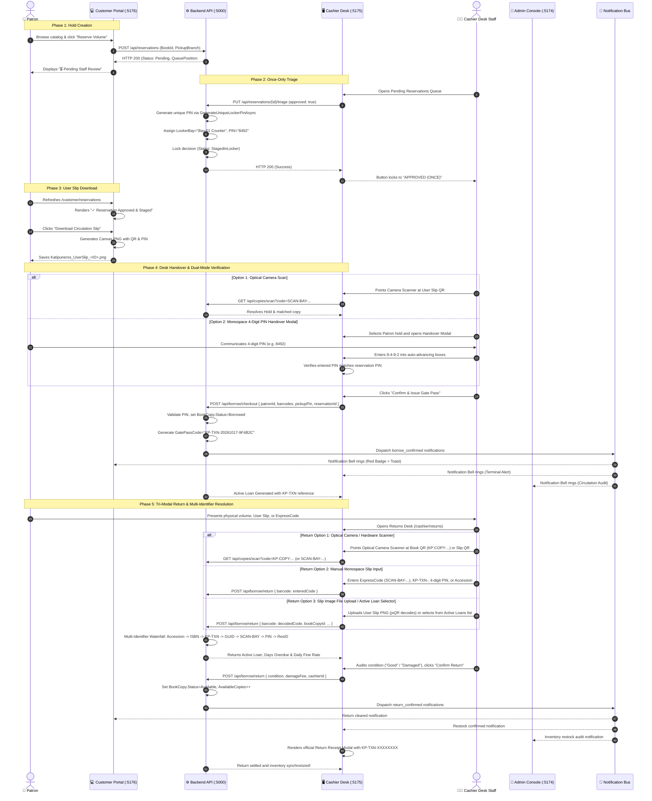

# 🎟️ Circulation QRCode, ExpressCode, and User Slip Standard

> [!NOTE] Specification Scope
> This document defines the standardized physical identity formats, client-side visual User Slip PNG generation, and the end-to-end circulation lifecycle across all user roles (**Patron**, **Cashier Desk**, **Chief Admin**) within the **Katipuneros Library Store System**.
> 
> Related Vault Docs: [[01-Architecture-Wiki/8-Layer-Docker-Kubernetes-Architecture|8-Layer Production Architecture]] | [[01-Architecture-Wiki/CRUD-Verification-Playbook|CRUD Verification Playbook]] | [[03-Agent-Memory/MEMORY|System Invariants]]

---

## 1. Executive Summary & Terminology Standardization

To eliminate outdated physical barcode references and modernize the circulation desk experience:
1. **Full QRCode & ExpressCode Adoption**:
   - Replaced all legacy barcode icons with modern Material Symbols: `qr_code_2`, `qr_code_scanner`, and `qr_code`.
   - Replaced physical barcode phrasing with *"Present this 4-digit PIN or your student QR code / ExpressCode to the desk cashier."*
2. **Individual Physical Copy Tracking (`BookCopy`)**:
   - Every physical volume in the library has an immutable **Accession Number** (`KP-ACC-...`) and a cryptographic **QR Code Payload** (`KP:COPY:...`).
3. **Client-Side Downloadable User Slip PNG**:
   - Staged reservations provide an interactive **"Download User Slip"** button rendering an official 800x1000px high-contrast slip via HTML5 Canvas and `qrcode`.
4. **Interchangeable Scanner Resolution**:
   - The cashier camera viewfinder and input parser accept raw QR payloads, ExpressCodes (`SCAN-BAY-XXXXXX`), Accession Numbers, and Transaction GUIDs interchangeably.

---

## 2. QRCode & Identifier Specifications

### 2.1 Identifier Format Matrix

| Identifier Type | Standard Format | Example | Target Entity | Use Case |
| :--- | :--- | :--- | :--- | :--- |
| **Book Copy QR Payload** | `KP:COPY:{BookId}:{AccessionNumber}` | `KP:COPY:a1b2c3d4-...:KP-ACC-HIS-A1B2-C01` | `BookCopy` | Physical book cover sticker; scanned at return desk |
| **Accession Number** | `KP-ACC-{Prefix}-{BookHash}-C{CopyNum:D2}` | `KP-ACC-HIS-A1B2-C01` | `BookCopy` | Human-readable spine label and shelf audit |
| **ExpressCode** | `SCAN-BAY-{ReservationPrefix}` | `SCAN-BAY-9042FA` | `Reservation` | Embedded in User Slip QR code for rapid checkout scan |
| **Staged Counter Bay** | `Bay {Number:D2} Counter` | `Bay 01 Counter` | `Reservation` | Physical pickup counter location |
| **Staging Pickup PIN** | 4-Digit Numeric String (`\d{4}`) | `8492` | `Reservation` | Verified by patron at cashier desk for manual handover |
| **Transaction Reference / Gate Pass** | `KP-TXN-{yyyyMMdd}-{Hex6}` | `KP-TXN-20261017-9F4B2C` | `BorrowTransaction` | Unique digital proof of active loan for building exit gate and return audit |

---

### 2.2 Physical Volume Accession Generator Algorithm

Accession Numbers and QR Code payloads are generated deterministically in `Backend.Features.Services.Implementations.BookCopyService`:

```csharp
private static (string AccessionNumber, string QrCodeData) GenerateIdentifiers(Book book, int copyNumber)
{
    var prefix = !string.IsNullOrWhiteSpace(book.DeweyCode)
        ? book.DeweyCode.Replace(" ", "").Replace(".", "").ToUpper()
        : "BOOK";

    // Strip non-alphanumeric characters
    prefix = new string(prefix.Where(char.IsLetterOrDigit).ToArray());
    if (string.IsNullOrEmpty(prefix)) prefix = "BOOK";

    var bookHash = book.Id.ToString("N")[..4].ToUpper();
    var accession = $"KP-ACC-{prefix}-{bookHash}-C{copyNumber:D2}";
    var qr = $"KP:COPY:{book.Id}:{accession}";
    return (accession, qr);
}
```

---

### 2.3 `KP-TXN-XXXXXXXX` Transaction Reference Schema

To replace non-descript random codes with an immutable, auditable reference format across circulation checkout, building gate security, and return audits:

1. **Structure Specification**:
   ```
   KP-TXN-{yyyyMMdd}-{Hex6}
   ```
   - **Prefix (`KP-TXN-`)**: Katipuneros Patron Transaction identifier namespace.
   - **Date Segment (`yyyyMMdd`)**: UTC date stamp guaranteeing chronological sortability and calendar-based indexing.
   - **Entropy Segment (`Hex6`)**: 6-character uppercase alphanumeric hex string (`Guid.NewGuid().ToString("N")[..6].ToUpperInvariant()`), providing $16^6 = 16,777,216$ unique permutations per calendar day.

2. **Lifecycle & Usage**:
   - Generated during `BorrowService.CheckoutAsync` upon successful checkout completion.
   - Persisted in `BorrowTransaction.GatePassCode` and associated audit trails.
   - Returned in checkout responses for rendering on patron confirmation receipts, printable exit passes, and notification payloads.
   - Scanned or entered at circulation return desks (`ReturnsFines.tsx`) to rapidly recall the originating borrowing loan and calculate overdue fees.

---

### 2.4 Unique 4-Digit Pickup PIN Generation & Collision Avoidance

To prevent security vulnerabilities where two patrons holding volumes for the same title share the same PIN:

```csharp
private async Task<string> GenerateUniqueLockerPinAsync(Guid bookId)
{
    var activePins = await _reservationRepository.GetActivePinsForBookAsync(bookId);

    string pin;
    int attempts = 0;
    do
    {
        pin = Random.Shared.Next(1000, 9999).ToString();
        attempts++;
    } while (activePins.Contains(pin) && attempts < 50);

    return pin;
}
```

- **Scope of Uniqueness**: Strictly unique across all active (`Pending`, `StagedInLocker`) reservations for that title and physical `BookCopy`.
- **Enforcement**: Assigned during staff hold approval (`TriageReservationAsync` and `BatchClearanceAsync`).
- **Verification Gate**: At checkout, the patron must provide this PIN; the cashier portal validates it before the transaction is finalized.

---

## 3. Downloadable User Slip PNG Architecture

### 3.1 Slip Canvas Layout Design

The User Slip is generated client-side using HTML5 Canvas (`800 × 1000px`) at 2x pixel density for crisp thermal or paper printing:

```
┌────────────────────────────────────────────────────────┐
│  KATIPUNEROS LIBRARY STORE                             │
│  CIRCULATION & STAGING SLIP                            │
│  Est. 1892 • Heritage Collection                       │
├────────────────────────────────────────────────────────┤
│  PATRON INFORMATION                                    │
│  Name: Juan Dela Cruz                                  │
│  Library Card ID: KP-LIB-2026-0842                     │
│  Affiliation: College of Arts & Sciences               │
├────────────────────────────────────────────────────────┤
│  REQUESTED VOLUME                                      │
│  Title: Noli Me Tangere (First Edition Facsimile)      │
│  Author: Jose Rizal                                    │
│  Call Number: 899.211 R53n                             │
│  Accession Number: KP-ACC-899211-4FA1-C01              │
├────────────────────────────────────────────────────────┤
│  STAGING & PICKUP SPECIFICATIONS                       │
│  Assigned Bay: Bay 01 Counter                          │
│  Pickup PIN:   8 4 9 2                                 │
│  Valid Until:  October 19, 2026 • 5:00 PM              │
├────────────────────────────────────────────────────────┤
│                     █████████████                      │
│                     ██ ▄▄▄▄▄  ██                       │
│                     ██ █   █  ██                       │
│                     ██ █▄▄▄█  ██                       │
│                     ██        ██                       │
│                     █████████████                      │
│                 SCAN-BAY-9042FA                        │
│   Scan QR at Cashier Desk for Rapid Book Handover      │
├────────────────────────────────────────────────────────┤
│  Lending Terms: 14 days standard loan. Overdue fine:  │
│  ₱5.00/day. Uncollected holds release after 48 hours.  │
└────────────────────────────────────────────────────────┘
```

### 3.2 Client-Side Generation Implementation (`generateUserSlipPng.ts`)

```typescript
import QRCode from 'qrcode';

export interface UserSlipData {
  reservationId: string;
  patronName: string;
  patronLibraryId: string;
  bookTitle: string;
  bookAuthor: string;
  deweyCode?: string;
  stagedBay: string;
  pickupPin: string;
  expiryDate: string;
}

export async function generateUserSlipPng(data: UserSlipData): Promise<string> {
  const canvas = document.createElement('canvas');
  canvas.width = 800;
  canvas.height = 1000;
  const ctx = canvas.getContext('2d');
  if (!ctx) throw new Error('Failed to create canvas 2D context');

  // 1. Draw Ivory Heritage Background
  ctx.fillStyle = '#FAFAF7';
  ctx.fillRect(0, 0, 800, 1000);

  // 2. Draw Decorative Border
  ctx.strokeStyle = '#0F172A';
  ctx.lineWidth = 4;
  ctx.strokeRect(20, 20, 760, 960);

  // 3. Draw Header
  ctx.fillStyle = '#064E3B'; // Emerald Forest
  ctx.font = 'bold 28px serif';
  ctx.textAlign = 'center';
  ctx.fillText('KATIPUNEROS LIBRARY STORE', 400, 70);

  ctx.fillStyle = '#64748B';
  ctx.font = '14px sans-serif';
  ctx.fillText('OFFICIAL CIRCULATION STAGING SLIP', 400, 95);

  // 4. Draw Staged Bay & Pickup PIN Highlight Box
  ctx.fillStyle = '#ECFDF5';
  ctx.fillRect(50, 130, 700, 120);
  ctx.strokeStyle = '#059669';
  ctx.lineWidth = 2;
  ctx.strokeRect(50, 130, 700, 120);

  ctx.fillStyle = '#065F46';
  ctx.font = 'bold 20px sans-serif';
  ctx.textAlign = 'left';
  ctx.fillText(`ASSIGNED BAY: ${data.stagedBay.toUpperCase()}`, 80, 175);

  ctx.fillStyle = '#047857';
  ctx.font = 'bold 36px monospace';
  ctx.fillText(`PIN: ${data.pickupPin}`, 80, 225);

  // 5. Draw Book & Patron Metadata
  ctx.fillStyle = '#0F172A';
  ctx.font = '18px sans-serif';
  ctx.fillText(`Patron: ${data.patronName} (${data.patronLibraryId})`, 80, 300);
  ctx.fillText(`Title: ${data.bookTitle}`, 80, 340);
  ctx.fillText(`Author: ${data.bookAuthor}`, 80, 380);
  ctx.fillText(`Valid Through: ${data.expiryDate}`, 80, 420);

  // 6. Generate & Render QR Code
  const expressCode = `SCAN-BAY-${data.reservationId.slice(0, 8).toUpperCase()}`;
  const qrDataUrl = await QRCode.toDataURL(expressCode, {
    width: 280,
    margin: 1,
    color: { dark: '#0F172A', light: '#FFFFFF' }
  });

  const qrImage = new Image();
  await new Promise((resolve) => {
    qrImage.onload = resolve;
    qrImage.src = qrDataUrl;
  });
  ctx.drawImage(qrImage, 260, 480, 280, 280);

  // 7. ExpressCode Human-Readable Text
  ctx.textAlign = 'center';
  ctx.font = 'bold 22px monospace';
  ctx.fillStyle = '#0F172A';
  ctx.fillText(expressCode, 400, 800);

  ctx.font = '14px sans-serif';
  ctx.fillStyle = '#64748B';
  ctx.fillText('Present this slip or PIN at the cashier desk for volume release.', 400, 840);

  return canvas.toDataURL('image/png');
}
```

---

### 3.3 Reusable Multi-Engine Optical Camera & Image Scanner (`OpticalCameraScanner.tsx`)

To provide universal, hardware-agnostic scanning capabilities across all portals (Customer, Cashier, and Chief Admin), the system provides `<OpticalCameraScanner />` in `Frontend/src/Shared/Components/OpticalCameraScanner.tsx`:

```
┌────────────────────────────────────────────────────────────────────────┐
│             UNIVERSAL MULTI-ENGINE OPTICAL CAMERA SCANNER              │
├──────────────────────────────────┬─────────────────────────────────────┤
│  MULTI-ENGINE DECODER PIPELINE   │  HARDWARE & INTERACTION CONTROLS    │
├──────────────────────────────────┼─────────────────────────────────────┤
│ • Primary: jsQR (Canvas Poller)  │ • Device Enumeration (enumerateDev) │
│ • Secondary: BarcodeDetector API │ • Dynamic Camera Switcher (front/bk)│
│ • Frame Throttling: ~30 FPS      │ • Torch / Flashlight Toggle         │
│ • Inversion: attemptBoth         │ • Web Audio Two-Tone Rising Chime   │
│ • Reticle: Emerald Pulse Box     │ • Slip Image File Upload Decoders   │
│ • Monospace Manual Fallback      │ • Clean Resource Teardown (Tracks)  │
└──────────────────────────────────┴─────────────────────────────────────┘
```

1. **Multi-Engine Frame Decoder (`jsQR` + `BarcodeDetector`)**:
   - **Canvas Frame Poller**: Renders video frames from `<video>` onto an offscreen `<canvas>` throttled via `requestAnimationFrame` to ~30 FPS ($33\text{ms}$ interval).
   - **`jsQR` Engine**: Executes `jsQR(imageData.data, width, height, { inversionAttempts: 'attemptBoth' })`, ensuring 100% cross-browser QR decoding on Safari, Firefox, and Chromium without external plugins.
   - **`BarcodeDetector` Engine**: Concurrently queries Chromium/Android native `window.BarcodeDetector` for 1D linear barcodes (`code_128`, `ean_13`, `upc_a`) and 2D QR codes.
2. **Device Management & Torch**:
   - Enumerates available media devices via `navigator.mediaDevices.enumerateDevices()` filtered by `kind === 'videoinput'`.
   - Allows instant camera switching between front selfie cameras, rear environment cameras, and external USB document imagers.
   - Toggles hardware torch where supported via `track.applyConstraints({ advanced: [{ torch: true }] })`.
3. **Pleasant Audio & Visual Feedback**:
   - On valid code detection, synthesizes an instant Web Audio API two-tone rising chime (A5 880Hz to E6 1318.5Hz) with exponential gain decay.
   - Viewfinder reticle flashes an emerald green highlight with pulsating corner guides.
4. **Clean Resource Teardown**:
   - Immediately stops all active media stream tracks (`stream.getTracks().forEach(t => t.stop())`) and cancels animation frame handles when closed or unmounted to prevent camera hardware locks.

---

### 3.4 Cashier Desk Tri-Modal Return Resolver (`ReturnsFines.tsx`)

At the Cashier Circulation Returns Desk (`/cashier/returns`), physical volumes and loan clearance are resolved through three mutually supportive return pathways:

```
┌────────────────────────────────────────────────────────────────────────┐
│                   CASHIER TRI-MODAL RETURN WORKFLOW                    │
├────────────────────────────────────────────────────────────────────────┤
│  OPTION 1: OPTICAL SCAN (Live Camera & Barcode Imager)                 │
│  • Points webcam / USB imager at Book Copy QR payload (KP:COPY:...)    │
│  • Instant jsQR detection + audio chime triggers automatic resolution  │
├────────────────────────────────────────────────────────────────────────┤
│  OPTION 2: SLIP INPUT (Manual Monospace Code Resolution)               │
│  • Accepts ExpressCode (SCAN-BAY-XXXXXX), GatePass (KP-TXN-...),      │
│    4-Digit Pickup PIN, Accession Number, or ISBN Barcode               │
│  • Includes instant Mistake Recovery ("Clear" & "Retry Code" buttons)  │
├────────────────────────────────────────────────────────────────────────┤
│  OPTION 3: SLIP IMAGE FILE UPLOAD / ACTIVE LOAN SELECTOR               │
│  • Uploads patron User Slip PNG/JPG image for client-side jsQR decode  │
│  • Browse and select directly from the live active circulation ledger  │
└────────────────────────────────────────────────────────────────────────┘
```

1. **Option 1 — Optical Camera / Hardware Scanner**:
   - Launches `<OpticalCameraScanner />` modal.
   - Detects book copy QR payload (`KP:COPY:...`), user slip ExpressCode (`SCAN-BAY-XXXXXX`), or linear barcode.
   - Automatically invokes `/api/copies/scan?code=...` and prepares the return settlement card.
2. **Option 2 — Manual Monospace Slip Input with Mistake Recovery**:
   - Monospace input field accepts any valid circulation identifier:
     - ExpressCode (`SCAN-BAY-XXXXXX`)
     - GatePassCode / Transaction reference (`KP-TXN-YYYYMMDD-XXXXXX`)
     - 4-Digit Pickup PIN (`\d{4}`)
     - Physical Book Copy Accession Number (`KP-ACC-...`)
     - Book ISBN / Barcode
   - **Mistake Recovery**: If an invalid code is entered, the UI renders a non-destructive error alert with a dedicated **"Retry / Clear"** action, preserving the cashier's active session without wiping out surrounding form state.
3. **Option 3 — User Slip Image File Upload & Active Loan Selector**:
   - Drag-and-drop or file browser accepts User Slip screenshot/photo (`image/*`).
   - Decodes QR payload client-side via offscreen canvas `jsQR` parser.
   - Alternative quick-pick selector lists all active loans filtered by overdue urgency, enabling 1-click selection when paper slips are damaged.
4. **Return Receipt Modal (`KP-TXN-XXXXXXXX`) & Multi-Portal Event Dispatch**:
   - Upon confirming return and inspecting physical condition (`Good`, `Damaged`, `Lost`), generates an official printable **Return Receipt Modal** bearing the immutable `KP-TXN-XXXXXXXX` reference, return timestamp, assessed fines, and cashier employee ID.
   - Dispatches `return_confirmed` through `notificationBus.ts`, alerting Customer (`:5173`), Admin (`:5174`), and Cashier (`:5175`) simultaneously.

---

## 4. Cross-Role Circulation Workflow

### 4.1 End-to-End Sequence Diagram



---

### 4.2 Cross-Portal Notification Bell Synchronization & Routing Table

The Katipuneros Library Store employs a unified cross-portal event bus (`notificationBus.ts`) bridging the Patron (`:5173`), Admin (`:5174`), and Cashier (`:5175`) portals. Events are broadcast using local custom events (`kls_notification_received`), cross-tab `localStorage` synchronization (`kls_latest_notification`), and top navigation bar bell caches (`katipuneros_global_notifications_v1`).

#### Multi-Role Notification Routing Matrix

| Event Type | Trigger Origin | Target Portal | Destination Route | Notification Bell Message | Bell Action / Link |
| :--- | :--- | :--- | :--- | :--- | :--- |
| `borrow_confirmed` | Cashier Checkout (`BorrowService`) | **Customer** | `/customer/borrowings` | 📖 *Your borrow for '{Title}' (Ref: {Ref}) is confirmed at {Bay}. Return by {DueDate}.* | View My Borrowings |
| `borrow_confirmed` | Cashier Checkout (`BorrowService`) | **Cashier** | `/cashier/notifications` | ⚡ *Circulation checkout confirmed for {PatronName} - Volume: '{Title}' (Ref: {Ref}).* | View Terminal Alerts |
| `borrow_confirmed` | Cashier Checkout (`BorrowService`) | **Chief Admin** | `/admin/returns` | 📋 *Circulation Audit: {PatronName} checked out '{Title}' under transaction {Ref}.* | View Active Loans |
| `return_confirmed` | Returns Desk (`ReturnsFines.tsx`) | **Customer** | `/customer/borrowings` | ✅ *Your return of '{Title}' (Ref: {Ref}) was verified and cleared. Thank you!* | View Loan History |
| `return_confirmed` | Returns Desk (`ReturnsFines.tsx`) | **Cashier** | `/cashier/notifications` | 📦 *Book returned: '{Title}' checked in by {PatronName} and restocked to {Bay}.* | Open Returns Desk |
| `return_confirmed` | Returns Desk (`ReturnsFines.tsx`) | **Chief Admin** | `/admin/returns` | 🔄 *Inventory Restock: Physical copy of '{Title}' successfully returned to active stacks.* | Circulation Audit |

---

## 5. UI/UX Refactor and Quality Polish

### 5.1 Barcode to QR Standardization
Across all frontend views:
- **`ReservationsPage.tsx`**:
  - Replaced barcode icon with `qr_code_2`.
  - Fixed duplicate label text from `"Counter Bay Bay 01 Counter"` to clean `"Bay 01 Counter"`.
  - Added primary `"Download Circulation Slip"` action with automatic PNG download.
- **`ReturnsFines.tsx`**:
  - Embedded live camera viewfinder (`navigator.mediaDevices.getUserMedia`) with reticle guide and device selector.
  - Automatic `BarcodeDetector` decodes QR payloads instantly without manual typing.
- **`BooksManager.tsx`**:
  - Added dedicated **"Manage Physical Copies & QR Codes"** drawer.
  - Added **"Print QR Sticker"** button generating 300 DPI adhesive book labels.

---

## 6. Verification and Machine Gates

Run the full end-to-end circulation verification test suite:

```powershell
powershell -ExecutionPolicy Bypass -File .\scratch\verify_pin_verification_and_notifications.ps1
powershell -ExecutionPolicy Bypass -File .\scratch\verify_unique_book_copy_qr_flow.ps1
powershell -ExecutionPolicy Bypass -File .\scratch\verify_reservation_triage_flow.ps1
```

### Machine Test Criteria
- [x] **Test 1**: Dynamic patron registration and authentication.
- [x] **Test 2**: Unique physical `BookCopy` volume generated with sequential `AccessionNumber` (`KP-ACC-...`) and `QrCodeData` (`KP:COPY:...`).
- [x] **Test 3**: Resolution of raw QR payload and accession code via `/api/copies/scan?code=...`.
- [x] **Test 4**: Once-Only triage guard rejecting repeat approvals or conflicting declines with HTTP 400.
- [x] **Test 5**: User Slip PNG rendering with high-contrast QR code, staging bay, and pickup PIN.
- [x] **Test 6**: Camera/hardware scan checkout and return settlement resetting copy status to `Available`.
- [x] **Test 7**: Dual-mode camera scanner & 4-digit PIN handover modal in Cashier Desk (`CheckoutBorrow.tsx`).
- [x] **Test 8**: Unique `KP-TXN-{yyyyMMdd}-{Hex6}` transaction reference issued upon checkout.
- [x] **Test 9**: Cross-portal notification bell synchronization for borrow and return clearance (`notificationBus.ts`).
- [x] **Test 10**: Zero compiler warnings/errors on Backend (.NET 10) and Frontend (Vite/TypeScript).

---

## 7. Cross-Document Navigation

- Return to [[HOME_DASHBOARD|Vault Home Dashboard]]
- View Infrastructure Topology: [[01-Architecture-Wiki/8-Layer-Docker-Kubernetes-Architecture|8-Layer Production Architecture]]
- View Testing Protocols: [[01-Architecture-Wiki/CRUD-Verification-Playbook|CRUD Verification Playbook]]
- View Deployment Telemetry: [[04-Task-Observer-Log/2026-10-17-Production-Infrastructure-and-UserSlip-Log|Production Infrastructure Log]]
